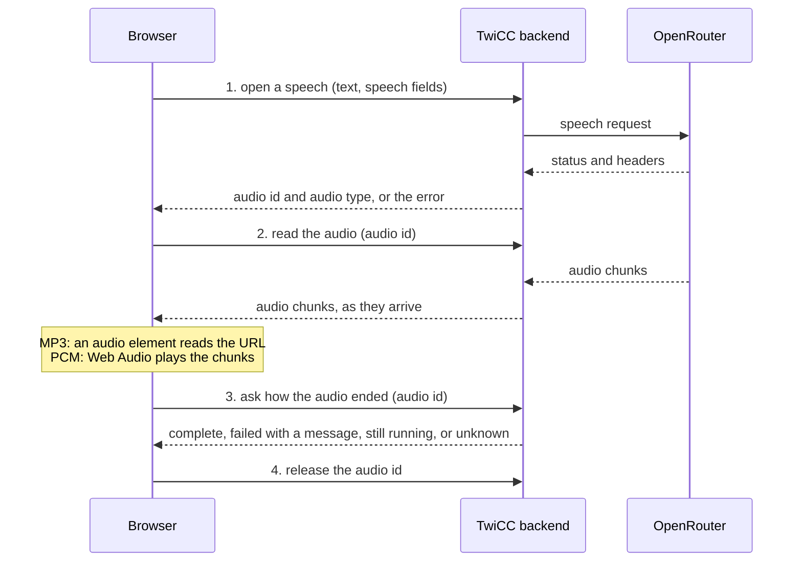

# Text-to-speech: streaming playback

Follows `docs/plans/2026-10-29-text-to-speech-design.md` (the "TTS spec" below). That spec lists
"No streaming playback" as a non-goal. This document replaces that point. Everything else in the
TTS spec stays true unless this document says otherwise.

## Problem

The audio plays only after TwiCC has received all of it. The wait grows with the text: with
HeyGen Voice Turbo, about 4 s for 770 characters and about 12 s for 3 000 characters (see
*Verified facts*). The user waits in silence, then the audio starts.

## Intent

Start the audio as soon as the first part of it arrives, and play the rest while it arrives.

The mechanism does not depend on the model. TwiCC does not know which provider sends its audio
progressively, and the models API does not say. TwiCC reads every response progressively:

- a provider that sends its audio progressively starts playing after about 1 s;
- a provider that sends everything at the end starts playing when the end arrives, as today.

There is no list of models, no detection, and no setting.

## Goals

- The audio starts when the first audio bytes arrive, for both formats (MP3 and PCM).
- Only standard web platform features, available in every current browser. No feature that only
  some browsers have.
- No regression: the error messages, the stop action, the states (`idle`, `loading`, `playing`),
  the rail indicator, the cache rules (key, 10-minute expiry, 50 MB cap), the test and validation
  flow, and the last test run stay as the TTS spec and the current settings section define them.
  Three changes: an error can now also come after the sound has started (see *How a playback
  ends*), the cache moves to the backend (see *Cache*), and any release before the audio is
  complete (a user stop or a browser-side error) records no test run and fills no cache entry
  (see *Last test run* and *Cache*).
- The last test run of a config also shows the time until the first audio arrived. This makes the
  benefit of a provider visible.

## Non-goals

- No splitting of long texts (still under *Later*).
- No detection of the formats a model supports. The test of a config still decides: a format that
  the model refuses fails the test with the upstream message.
- No transcoding (PCM to MP3 or the reverse).
- No playback controls (pause, seek). No seeking inside a playing audio.
- No change to the rail indicator, the floating toggle mark, or the visibility rule. The message
  button changes only to show a late error (see *How a playback ends*).
- No CHANGELOG entry (on explicit request only).

## Verified facts

Checked on 2026-10-30.

- **OpenRouter streams the response.** `heygen/heygen-voice-1-turbo:free`, `pcm`, read with an
  async HTTP client in streaming mode:

  | Text | Headers and first chunk | Last chunk | Audio length | Chunks |
  |---|---|---|---|---|
  | 769 characters | 1.16 s | 3.80 s | 42.7 s | 326 |
  | 3 079 characters | 0.97 s | 11.83 s | 165.9 s | 1 098 |

  The response has `Transfer-Encoding: chunked` and no `Content-Length`. The first chunk arrives
  after about 1 s for both lengths. The chunks then arrive steadily, about 15 times faster than the
  audio plays. The measure does not tell whether the provider's generation or the network sets this
  pace. It does not matter here: the audio can start with the first chunk.
- **The PCM rate varies by provider.** This HeyGen model answers
  `audio/pcm;rate=44100;channels=1`. The TTS spec measured `rate=24000` with other models. The
  rate comes from the `Content-Type`, with the TTS spec's fallback when it is missing, as today.
- **Upstream errors come before the audio.** The upstream status and headers arrive before the
  first audio byte. An upstream refusal (bad voice, bad format, missing key) is known before any
  audio is sent.
- **The models API has no format information.** `supported_parameters` is empty for every speech
  model, in the model list and in the per-model endpoints list
  (`GET /api/v1/models/<id>/endpoints`). The OpenRouter guide names only three cases: HeyGen Voice
  and Gemini TTS return only `pcm`, MiniMax returns only `mp3`.
- **MediaSource cannot stream MP3 in every browser.** `MediaSource.isTypeSupported('audio/mpeg')`
  is `false` in Firefox 158. A design based on MediaSource would not work in every browser.
- **The standard ways exist for both formats:**
  - an `<audio>` element plays an MP3 from an HTTP URL progressively, while it downloads;
  - the Web Audio API plays raw samples that the page gives it, chunk after chunk.

## Design overview

A speech uses four requests:

1. **Open.** The browser sends the text and the speech fields. The backend calls OpenRouter and
   waits for its status and headers. It answers with an audio id and the audio type, or with the
   error. All the current error rules apply to this step.
2. **Read.** The browser reads the audio by its id, with a plain HTTP `GET`. The backend sends the
   audio bytes as they arrive from OpenRouter.
3. **Ending.** When the player stops on its own (a normal end or an error), the browser asks the
   backend how the upstream stream ended.
4. **Release.** When the browser is done with the audio (after the ending step, or on a stop), it
   releases the audio id.

Why the open step: an `<audio>` element can only read a URL with `GET`, and the text does not fit
in a URL (messages reach tens of thousands of characters). The open step also returns an upstream
refusal with its message, before any player is involved.

Why the ending step: an `<audio>` element cannot report the server's error message (its
`MediaError` carries only a code and a browser-defined text), and browsers differ on how it
reports a cut download (an error, or sometimes a normal end). The backend knows how the upstream
stream ended, and can give its message. The browser knows how its own side ended. The service
combines both (see *How a playback ends*).

The same steps serve both formats. Only the player differs.

## Backend

### Open step

A REST endpoint behind the usual access checks. It replaces the current speech endpoint.

- It takes the same input as the current speech endpoint: the text, the speech fields, the optional
  `config_id` of a settings test. It also takes whether the cache applies (the settings test does
  not use it).
- It keeps every rule of the TTS spec's speech endpoint, except the response body: input
  validation, no key, upstream errors with their message and the generic-400 hint, never a `401`
  for an upstream error, always its own error message, never Django's error page, async view with
  an async upstream call.
- On a cache hit, it makes no upstream call. The audio id then serves the cached audio.
- Otherwise, it calls OpenRouter in streaming mode and waits for the status and headers only. On
  success, it answers the audio id and the audio type. On an upstream error or a non-audio
  success, it reads the (small) body for the message, as today.
- A success whose `Content-Type` is not audio is an upstream error, as today.
- When the browser cuts the open request, the upstream call closes, as today.

The read, ending and release steps follow the same rule as the open step: they always answer with
their own error message, never with Django's error page (in DEBUG it shows frame locals, and the
audio state holds the upstream call).

### Audio type

- MP3 and any non-PCM audio type: OpenRouter's type, unchanged.
- PCM: always `audio/pcm` with an explicit rate and channel count. The backend applies the TTS
  spec's rules: it reads them from OpenRouter's type, and falls back to 24 000 Hz mono, with a
  logged warning, when they are missing or implausible.
- PCM is not wrapped in a WAV header any more: the size is not known when the first bytes leave.

### Read step

A REST endpoint behind the usual access checks. It takes the audio id and sends the audio.

- **Progressive.** It sends each upstream chunk as soon as it arrives. No compression, no
  buffering by a middleware.
- **Several reads.** A browser can read a media URL with several requests: a probe, a restart, a
  range request. The backend keeps the bytes received so far, and serves every read of a live
  audio id:
  - a plain read: from the start of the audio, with the bytes already received, then with the live
    chunks, size unknown until the upstream stream ends;
  - a range read: standard HTTP cannot send chunks that have not arrived yet in a range answer (a
    `206` names its last byte before its body). Two standard answers exist: a `206` with only the
    bytes already received (total size `*` while unknown), or a full plain read that ignores the
    range. The risk checks decide which one the browsers need.
- **Failure.** When the upstream stream fails, the backend ends the open reads abnormally, not with
  a normal end. A later read of a failed audio id gets the bytes received, then the same abnormal
  end. This is a hint for the player; the ending step is the reference.
- **Timeout.** The upstream timeout applies to each wait (the headers, each gap between chunks),
  not to the whole audio. A long audio that keeps flowing never times out.

### Ending step

A REST endpoint behind the usual access checks. It takes the audio id and answers at once, with
the current state of the upstream stream:

- **complete**: the backend received the end of the upstream stream;
- **failed**, with a message: the upstream timed out, the upstream connection broke, or another
  error occurred. The messages follow the current ones ("OpenRouter did not answer in time", "Could
  not reach OpenRouter", …);
- **running**: the upstream stream has not ended yet;
- **unknown**: the audio id does not exist (for example after a backend restart).

It never waits. The browser side decides what to show (see *How a playback ends*).

### Lifetime of an audio id

The playback lasts much longer than the download: the 3 079-character audio above is fully
received after 12 s and plays for 166 s. The audio id must outlive its reads.

- **Until released.** An audio id, finished or not, lives until the browser releases it. The
  backend then closes the upstream call at once, if it still runs, and drops the bytes it keeps
  (the cache keeps its own copy of a complete audio).
- **No reader is not a stop.** A media element can close its read after it has buffered ahead,
  and come back later. So the backend never closes an upstream call because no reader is
  connected. A page reload or a closed tab cannot be relied on to send a release (a request sent
  while the page unloads is best effort): its upstream call then runs to its end, and the safety
  expiry frees it. The generation is already under way, so this costs about the same as a
  full playback. This is accepted. The same holds after a logout or an expired access: the sound
  stops, but the release cannot pass the access check.
- **Unclaimed.** An audio id that no reader claims expires after a short delay (tens of seconds).
  Its upstream call closes then.
- **Safety expiry.** An audio id that is never released (the page vanished) expires after a long
  delay, longer than any playback. Until then the backend holds its bytes: up to about a hundred
  MB for a long PCM audio. The backend holds one audio per open TwiCC page, plus one per playback cut by a reload or
  a closed tab, until its safety expiry. This is accepted.
- **Unguessable.** The audio id is random and long enough not to be guessed. It is only valid in
  the backend process that created it.

### Cache

The cache moves from the browser to the backend. An `<audio>` element reads the bytes itself: the
page never holds them, so the browser cannot store them.

- Same rules as the TTS spec: the key is the text plus the speech fields, entries expire after
  10 minutes, the total size is capped at about 50 MB, an audio larger than the cap plays but is
  not stored. An evicted entry frees its memory. An audio id that serves it keeps its audio until
  the browser releases the id.
- Only a **complete** audio enters the cache (the backend received the end of the upstream stream).
  A browser stop after that point does not prevent it. A failed audio, or one released before its
  end, does not enter the cache. This is a change: today a message stopped during its playback is
  already cached. Now a message stopped before its audio is complete is not, and a replay costs
  again. This is accepted.
- The settings test neither reads nor fills the cache, as today.
- The cache is shared by every tab and device of the same TwiCC. This is new, and wanted: a
  message replayed on another device does not cost a second time.
- The browser cache of the TTS spec goes away.

### Last test run

- A settings test records its last test run when its audio is **complete**, as defined above. A
  browser stop after that point does not prevent the record, and neither does a browser-side error
  after that point (the browser refused to play, or its side was cut). A test whose upstream
  stream failed, or that was released before the end of its upstream stream, records nothing. Its
  cost may still be billed; TwiCC does not track it.
- This is a change: today every test that plays records its run, because the backend has the
  whole audio before the browser plays it. Now any release before the audio is complete (a user
  stop or a browser-side error) records nothing. This is accepted.
- The record keeps its current fields. `generation_ms` becomes the time from the start of the
  upstream call to the last chunk.
- A new field holds the time from the start of the upstream call to the first audio chunk.
- The cost lookup keeps its schedule and its retries, but starts when the audio is complete, not
  when the response starts. The TTS spec's "after a successful request" now means "after a
  complete audio". This keeps the lookup of a long test inside its retry window.
- A record written before this change has no first-audio time. It still shows, without that
  figure.

### Logs

One log line per speech, written when it ends, with the current fields plus the time to the first
audio chunk and the outcome: ok, upstream error, cancelled (the open request was cut), failed
during the stream, released before the end, expired unread, expired unreleased, or served from
the cache.

## Frontend

### The speech service

`play(text)`, `playWith(...)`, `stop()`, the states, the single app-wide playback, its survival
across navigation and the stop on logout stay as the TTS spec defines them. The outcome gains a
late part (see *How a playback ends*).

- **Open, then read.** `play` opens the speech. On an error, it returns the error as today. On
  success, it reads the audio with the player that fits the audio type.
- **Two players**, chosen by the audio type of the open step:
  - **PCM** (`audio/pcm…`): the page reads the audio URL as a stream and plays the samples with the
    Web Audio API, chunk after chunk, without gaps between chunks. The rate and the channel count
    come from the audio type. The samples are 16-bit little-endian, as today.
  - **Any other audio type** (`audio/mpeg`, …): an `<audio>` element reads the audio URL directly.
    The browser plays it while it downloads.
- **A short start buffer.** The PCM player starts when a small amount of audio has arrived
  (a fraction of a second), so a small delay in the network does not cut the sound. The `<audio>`
  element manages its own buffer.
- **Slow streams.** When the audio arrives slower than it plays, the playback waits for the next
  chunk and goes on. This is not an error.
- **States.** `loading` lasts from the click until the sound actually starts. `playing` lasts until
  the playback ends (see *How a playback ends*). Then `idle`.
- **Stop.** `stop()` stops the sound, closes the read (or aborts the open step), and releases the
  audio id.
- **Autoplay.** Both players are unlocked inside the user's click, before any network wait, as the
  current player is.

### How a playback ends

The outcome of `play` has two parts:

1. **Start.** It resolves when the sound starts, or with the error that prevented the start, as
   today. The settings test asks "Did you hear it correctly?" when the sound starts, as today.
2. **End.** It resolves when the playback ends: a normal end, or an error with its message.

When the player stops on its own, the service asks the backend how the upstream stream ended
(*Ending step*), then releases the audio id. The state does not change during this short request:
`loading` before the first sound, `playing` after. Then the state returns to `idle`. The result
combines the browser side and the backend side:

| The player | Backend answer | Result |
|---|---|---|
| ended normally | complete | normal end, nothing to show |
| ended normally | failed | error, with the backend's message |
| ended normally | running | error: the audio stopped before the end (the browser side was cut) |
| reported an error | failed | error, with the backend's message |
| reported an error | complete or running | error, with the service's own message: the browser refused to play the audio or could not reach TwiCC (both as today), or the audio stopped before the end |
| ended normally | unknown, or no answer | normal end, nothing to show (the backend restarted or the network dropped after the download: the user most likely heard everything) |
| reported an error | unknown, or no answer | error: the audio is no longer available, or could not reach TwiCC |

- An error before the first sound goes to the start part. An error after it goes to the end part.
- The player may stop at once, or after the sound already received. This depends on the player
  and the browser. The message is the same.
- A stop by the user or by the service (another `play`, `available` turning false, logout) is not
  an error. There is no ending step and nothing to show. The audio id is released.
- **Accepted limit.** The size of the audio is unknown while it streams. If the browser side is
  cut and the player sees a normal end (a proxy can turn a cut into a normal end, and some
  browsers do for `<audio>`), the service cannot see the cut when the backend answers complete or
  unknown. It shows nothing. This holds for both players.

What the callers show for an error in the end part:

- **Message button:** a toast, like the start errors.
- **Settings test:** the error under the config, like the start errors. If the user has not
  answered "Did you hear it correctly?" yet, the prompt goes away and the config stays
  unvalidated. A **Yes** given before the error stands: the user judged what they heard.

### The settings section

Two visible changes:

- the late error of a test, as above;
- the time to the first audio, in the last test run: in the summary stats line, and in the exact
  figures at the top of the card. The exact wording follows the current lines.

## Compatibility

- `tts.json` keeps its shape. The last test run gains one optional field.
- No migration, no new setting.

## Risks to check first

The plan starts with these checks, before it builds on them. Browsers: Chrome, Firefox and Safari
on desktop; Safari on iOS and iPadOS (in practice, every browser there uses WebKit); Chrome and
Firefox on Android. Paths: directly on the backend, and through the Vite dev proxy.

- An `<audio>` element plays the read URL progressively, through TwiCC's access checks:
  - with the requests it chooses to send (probes, range requests, a read closed after buffering
    and resumed later);
  - with a locked screen and with the page in the background, on iOS, iPadOS and Android;
  - with a long wait before the first byte and long gaps between chunks, up to the upstream
    timeout.

  The check also tells which range answer each browser needs (see *Read step*).
- The Web Audio player plays chunks of different sizes without an audible click between them.
- **Web Audio on mobile.** On iOS and iPadOS, the silent switch can mute Web Audio, and a locked
  screen can suspend it; an `<audio>` element keeps playing in both cases. Android browsers can
  suspend Web Audio in the background too. The check covers the locked screen, the background and
  the silent switch.
- `stop()` releases the audio id and closes the upstream call at once.
- Django sends the read response chunk by chunk with the current middleware stack, directly and
  through the Vite dev proxy, including long gaps between chunks.

**Decision rule.** Where a check fails for a format on a platform, that format keeps today's
behaviour there: the page receives the whole audio, then plays it with an `<audio>` element. For
PCM, the page adds the WAV header itself (the backend no longer does). There is no regression
there, only no gain. The other format still streams.

## Left to the builder

- Endpoint paths, payload and field names, the form of the audio id.
- The expiry delays, the start buffer length, the chunk sizes.
- How a page detects the platforms where the decision rule applies.
- How the backend keeps the received bytes, and how it measures the cache size.
- How the late part of the outcome reaches the callers.
- The exact wording of the messages and of the first-audio figure.

## Later

- **Long texts:** split at sentence boundaries (TTS spec, *Later*). With streaming, the main gain
  left is for providers that send their audio only at the end.
- **Format detection:** when the user picks a model, probe both formats with a tiny text and offer
  only the formats that work. Each probe is a billed call.
